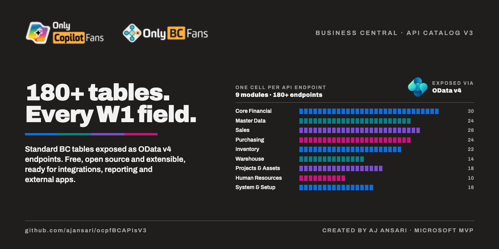

# OnlyCopilotFans Business Central API Catalog v3.1

**Publisher:** OnlyCopilotFans  
**API Version:** v3.1 (all endpoints also served at v3.0 for existing integrations)  
**App Version:** 3.1.3.0  
**Object Range:** 90800–91099  
**BC Version:** Business Central 2025 Wave 2 (v27.5+)  
**Date:** June 9, 2026 (v3.0) — updated July 7, 2026 (v3.1) — updated September 9, 2026 (v3.1.2, v3.1.3)  
**Created by:** AJ Ansari ( [Email](mailto:aj@onlycopilotfans.com) | [LinkedIn](https://linkedin.com/in/ajansari) )

## Overview

**OCPF APIs** is a Microsoft Dynamics 365 Business Central extension that exposes 187 standard BC tables as OData v4 API endpoints. It is designed to be a comprehensive, ready-to-use API layer for integrations, reporting tools, and external applications that need reliable, structured access to Business Central data without requiring custom development per table.

Each API page maps directly to a standard BC source table and exposes every standard field from that table, with the deliberate exception of fields that are specific to country/region localizations. This keeps the API surface globally portable — the same endpoints and field set work consistently across any BC environment regardless of the localization installed.

## For full documentation, view Documentation.md in the [Documentation](https://github.com/ajansari/ocpfBCAPIsV3/blob/main/Documentation/Documentation.md) folder.

## What changed

### v3.1.3 (September 2026)

- **New Access Control category** (`ocpf_accessControl`, 4 pages, v3.1-only, object IDs 91000–91003; app ID range extended to 90800–91099) — for automations, external apps, and agents that configure BC security:
  - `ocpfPermissionSets` (read) — every permission set in the environment: base, extension (AppSource/PTE), and tenant-defined, each with its `scope` and `appId`.
  - `ocpfPermissionSetPermissions` (read) — the fully expanded object-level permissions of any set.
  - `ocpfUsers` (read) — users and security groups (groups are the `AAD Group` / `Windows Group` rows; their `userSecurityId` is the group's assignee ID).
  - `ocpfPermissionSetAssignments` (read/write) — assign an existing permission set to a **user** (POST) or revoke it (DELETE). Requires SUPER or the SECURITY permission set.
- **What these endpoints can and cannot do** — you can list permission sets and their permissions and assign existing sets to individual users. You **cannot** create or edit custom (tenant) permission sets, add or change individual permissions, or assign a permission set to a **security group**; do those in the Business Central UI. See **Key characteristics → Access control endpoints** in [Documentation.md](https://github.com/ajansari/ocpfBCAPIsV3/blob/main/Documentation/Documentation.md) for the full boundary.
- Catalog: 187 entities (135 editable / 52 read-only). `OCPF - READ` covers all 187; `OCPF - READ/WRITE` covers 135. App version 3.1.2.0 → 3.1.3.0.

### v3.1.2 (September 2026)

- **18 pages corrected from read-only to editable** — setup and working-document entities that had been mis-marked as read-only now support POST/PATCH/DELETE: Projects, Project Tasks / Planning Lines / Posting Groups, Fixed Assets, FA Posting Groups, FA Depreciation Books, General Journal Templates & Batches, Price List Headers & Lines, Company Information, Document Attachments, Reminders (header/line), Finance Charge Memos (header/line), and Calendar Absence Entries. Catalog is now **134 editable / 49 read-only**; `OCPF - READ/WRITE` covers 134 pages.
- **`DataAccessIntent = ReadOnly` on the 49 immutable pages** — ledgers, registers, and posted documents now serve their GET queries from the SQL read-only replica, offloading reporting/extract load from the primary. Non-breaking; the only effect is a few seconds of replication lag on freshly written data. Applies to both `/v3.0/` and `/v3.1/`.
- **App version** 3.1.1.0 → 3.1.2.0. No endpoint or contract changes.

### v3.0 → v3.1 (July 2026)

v3.1 is an **additive, non-breaking** release — all v3.0 endpoints keep working unchanged.

- **Dual-versioned endpoints** — every existing API page is served at both `/v3.0/` and `/v3.1/` base URLs. New entities are published at v3.1 only, so **new integrations should use `/v3.1/`**.
- **170 missing standard fields restored on 22 existing entities** — v3.0's generator had skipped every field with parentheses in its name (e.g. `Credit Limit (LCY)` on Customer, `Cost Amount (Actual)` on Value Entry, and the `(LCY)`/`(Qty.)` flow fields on Customer, Vendor, Item, and ledger entities). These appear on both versions, which is additive and safe for existing OData clients.
- **65 new entities (v3.1 only)** — Ship-to Addresses, a new **Manufacturing** category (34 entities: work/machine centers, routings, production BOMs, production orders, capacity, and assembly management), and a new **Service Management** category (30 entities: service items, service documents, contracts, loaners, ledgers, and posted service documents).
- **5 more entities (v3.1.1)** — Vendor Bank Accounts (Master Data); Sales Line Discounts and Customer Invoice Discounts (Sales); Purchase Line Discounts and Vendor Invoice Discounts (Purchasing). The Sales Line Discount and Purchase Line Discount API pages remain available even though the underlying BC tables are marked for deprecation, because the V16 pricing model is still an opt-in feature in BC. We will adjust this in the future once Microsoft enables the new pricing tables by default.
- **Fixes & housekeeping** — corrected tooltips that had shifted onto neighboring fields, expanded permission sets (READ: 183 pages, READ/WRITE: 116), app version 3.1.1.0, and git tags `v3.0.0.0` / `v3.1.0.0` (diff them for the full contract delta).

The complete field-by-field delta is in [ChangeLog.md](https://github.com/ajansari/ocpfBCAPIsV3/blob/main/Documentation/ChangeLog.md).

## Roadmap

- ~~Service Management~~ — ✅ shipped in v3.1
- ~~Manufacturing (Production)~~ — ✅ shipped in v3.1 (including Assembly)
- ~~`DataAccessIntent = ReadOnly` on read-only pages, for read-replica offload~~ — ✅ shipped in v3.1.2 (also corrected 18 pages that should have been editable)
- ~~APIs for permission / access-control tables~~ — ✅ shipped in v3.1.3 as the `ocpf_accessControl` category: read access to permission sets, their permissions, and users; read/write assignment of existing permission sets to **individual users**. Creating custom permission sets and assigning to security groups are not included — see the Documentation "Access control endpoints" section.

## Automated Business Central PR review

The **Business Central PR review** workflow reviews opened, updated, reopened, and ready-for-review PRs. It maintains one report on the PR and publishes an **AL review verdict** check:

- 🟢 **Green:** all required checks and coverage passed; still requires human approval.
- 🟡 **Yellow:** risks, warnings, or incomplete coverage (including unavailable compilation, AI review, or runtime tests).
- 🔴 **Red:** a confirmed static blocker, failed compilation/analyzer, or Git merge conflict.

The report separates the contributor's request, static findings, compilation, analyzers, runtime tests, Git mergeability, and optional AI interpretation. Static source analysis checks API contract changes, object IDs/routes, permissions, write flags, triggers, and release-documentation consistency. It is deliberately conservative: it cannot resolve underlying table field types, replace an AL compiler, or establish that runtime behavior is correct. Overlaps with other open PRs are not automatically evaluated.

### Repository configuration

After merging this automation into the PR base branch, configure **Settings → Secrets and variables → Actions → Variables**:

| Variable | Purpose |
| --- | --- |
| `AL_REVIEW_SYMBOLS_URL` | HTTPS URL to an administrator-managed ZIP containing trusted BC symbol `.app` files at its root. Include System, System Application, Base Application, Application, and any dependencies for the supported BC target. Use a URL without credentials or access tokens; symbols must be downloadable without secrets. |
| `AL_REVIEW_SYMBOLS_SHA256` | SHA-256 of that ZIP. Update alongside the URL when the BC target changes. |
| `AL_REVIEW_DISTRIBUTION` | `PTE`, `AppSource`, or `Both`. CodeCop always runs when compilation is configured; this selects PerTenantExtensionCop, AppSourceCop, or both. Until the deployment target is selected, coverage remains yellow. |
| `AL_REVIEW_AI_ENABLED` | Set to `true` to opt into GitHub Models analysis of the PR title, description, and bounded diff. Repository/organization policy must permit sending that content to GitHub Models; quotas and model availability apply. Default: disabled. |
| `AL_REVIEW_AI_MODEL` | Optional GitHub Models model ID; default `openai/gpt-4.1`. Select a model available to the repository. |
| `AL_REVIEW_NOTIFY_USER` | Optional GitHub username, without `@`, to mention on the initial report and subsequent color changes. |

Compilation uses the pinned Microsoft AL development-tools package `16.2.28.57946` (runtime 16), with its checksum verified before execution. Both compilation and analyzer runs use only the candidate's manifest, AL sources, and referenced logo image, not its analyzer DLLs, rulesets, scripts, or build configuration. Logo paths must remain inside the candidate and cannot traverse symlinks. Diagnostics appear in the compilation job log. Keep the compiler and symbol set aligned with the supported application/runtime in `app.json`; this setup validates one configured BC target, not a compatibility matrix. Full AppSource submission validation and prior-release AppSourceCop baselines are not configured.

**Runtime tests are currently unavailable:** this repository has no committed AL test application or BC test-environment integration. The workflow explicitly reports that gap and does not claim to execute the locally excluded `ATS/` suite. As a result, even otherwise clean PRs remain yellow. Enabling compilation or AI alone cannot produce green. A trusted BC test runner and its verified results must be integrated before green is attainable; do not bypass this by marking skipped tests as passed.

AI output is advisory, not an approval or a source of confirmed blocking findings. Large/binary diffs receive an explicit partial-coverage warning. Deterministic findings and coverage determine the traffic light.

### Notifications and safety

Read reports on the PR, its Checks tab, or **github.com/notifications**. For email, verify your address in **Settings → Emails**, enable email delivery under **Settings → Notifications**, and watch this repository or subscribe to the PR. No email address or mail credentials are stored by this automation. Mentions follow GitHub's notification preferences; email delivery is not guaranteed.

The main review comment is updated rather than duplicated. With `AL_REVIEW_NOTIFY_USER` configured, a color change also produces one short mention comment, because editing an existing comment is not a reliable new-notification mechanism. Changes that keep the same color do not repeatedly mention you. Issues are not created automatically: create/link one only for requirements discussions or follow-up work outside the PR.

**Recommendations only; merging stays manual.** During PR review, the agent never edits tracked repository files, creates a remote branch, pushes a commit, or merges into `main` (or any other base branch). Its only GitHub writes are review/notification comments and check results.

**No additional test branch is needed.** Source checks and compilation use GitHub's temporary `refs/pull/<number>/merge` commit in isolated, detached checkouts. That tests the proposed combination of the PR and its base without changing either branch. Both parent SHAs are verified before validation; obsolete snapshots are rejected. If a conflict prevents GitHub from producing a merge snapshot, validation is unavailable and mergeability is reported separately—never green. Testing in a persistent branch would add cleanup and stale-branch risks without improving this isolation. This snapshot validation is compilation/static analysis, not deployment into a BC environment.

The workflow uses `pull_request_target` so fork PRs can receive a report. All executed scripts/workflow definitions come from the trusted base commit; candidate scripts are never executed. Source checks and compilation run on separate GitHub-hosted runners with read-only tokens, no repository secrets, and checkout credential persistence disabled. Only the trusted publishing job can write comments/checks; it has no `contents: write` permission. Treat PR text and model suggestions as untrusted; no auto-merge, auto-fix, deployments, or issue creation occurs. Workflow changes must first be manually reviewed and merged into the base branch before they affect incoming reviews.

The yellow check is **neutral**, not successful: GitHub does not have a native yellow check conclusion. Configure branch protection with care; this advisory review is not a substitute for a required successful build/test gate.

Local regression checks (Node.js 20+; no npm dependencies):

```sh
node --test .github/scripts/al-review.test.mjs .github/scripts/publish-review.test.cjs
```
